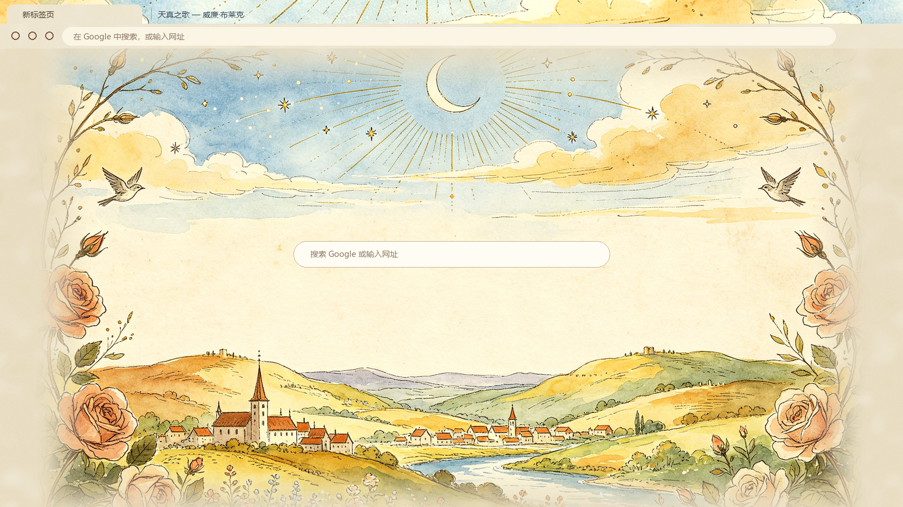

# Songs of Innocence — Chrome 主题

仿《天真与经验之歌》插画风的 Chrome 主题：羊皮纸、水彩天空、新月光芒、玫瑰藤蔓与田园村庄。



## 两个版本（左下角图片开关）

Chrome 主题只是一份静态配置，没有可点的设置项，所以「左下角图片」的开关做成两个版本：

| 文件夹 | 新标签页左下角小羊玫瑰图 |
|---|---|
| `theme/` | 显示 |
| `theme-no-corner/` | 不显示 |

切换方法：在扩展页移除当前主题，加载另一个文件夹即可（或直接加载另一个，新主题会替换旧的）。

## 安装
1. 下载本仓库（或 Releases 里的 zip 并解压）
2. Chrome 地址栏打开 `chrome://extensions`，右上角打开「开发者模式」
3. 点「加载已解压的扩展程序」，选择 `theme` 或 `theme-no-corner` 文件夹

恢复默认：`chrome://settings/appearance` → 主题 → 「重置为默认设置」。

## 重新生成
需要 Python 3 + Pillow（`pip install pillow`）。素材在 `source/`。

```bash
python tools/build.py              # 两个版本都生成
python tools/build.py --corner on  # 只生成带角图版
python tools/build.py --corner off # 只生成无角图版
```

改完后在 `chrome://extensions` 里点该主题的刷新按钮。
